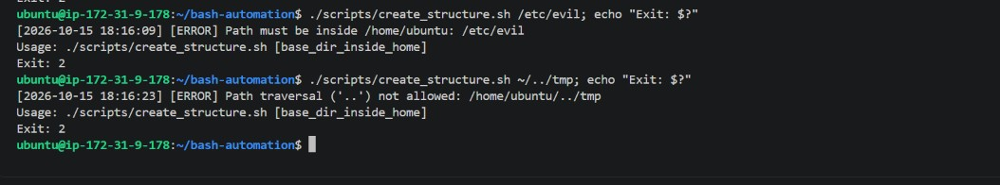
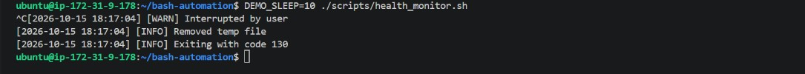

# Bash Automation Project

Bash scripts for directory automation and system health monitoring, built on Ubuntu EC2.

## Structure
| Path | Purpose |
|---|---|
| `scripts/create_structure.sh` | Idempotent nested dir/file creation with timestamped names |
| `scripts/health_monitor.sh` | Checks disk, memory, CPU against a threshold; reports via exit codes |
| `scripts/lib/common.sh` | Shared functions: logging, validation, threshold checks |
| `docs/` | Notes | 
| `screenshots/` | Evidence of execution |

## Usage
```bash
chmod +x scripts/*.sh
./scripts/create_structure.sh [base_dir]
./scripts/health_monitor.sh [disk_path] [threshold_percent]
```

## Script Logic
**create_structure.sh**: `mkdir -p` and `[[ -f ]]` checks make it safe to re-run. Static files are never overwritten; log/report files get a `date +%Y%m%d_%H%M%S` timestamp.

**health_monitor.sh**: Collects metrics with `df`, `free`, `/proc/loadavg`, `ps` into variables, compares each to the threshold, and captures each result's exit code with `$?`. Exit 0 = healthy, 1 = alert, 2 = bad input, 130 = interrupted.

**common.sh**: Sourced library using `local` variables and arguments (`$1`, `$2`).

## Safety Features
- `set -euo pipefail` in all scripts
- Path validation: must be inside `$HOME`, no `..`, safe characters only
- Threshold validation: integer 1-100
- `trap` removes temp files on exit, Ctrl+C or kill

## Results


## Challenges
(2-3 real ones, e.g. `set -e` killing the script on a non-zero return, quoting problems, SIGPIPE with `head`.)

## Screenshots



